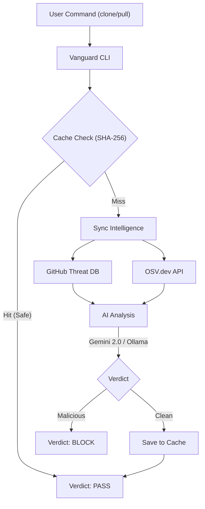

# 🛡️ Vanguard

**Enterprise-Grade AI Supply Chain Firewall for Git.**

[](https://opensource.org/licenses/MIT)
[](https://www.npmjs.com/package/vanguard-cli)
[](https://github.com/bazobehram/vanguard/actions)
[](https://deepmind.google/technologies/gemini/)

Vanguard intercepts `git clone` and `git pull` operations to perform deep, AI-powered security audits. It blocks malicious logic, dependency poisoning, and supply chain threats **BEFORE** they reach your local development environment.

---

## 🏗️ Architecture

Vanguard operates as a protective layer between your command line and the remote repository. It combines local heuristics with global intelligence.



---

## 💎 Key Features

*   🧠 **Hybrid Intelligence**: Leverages **Google Gemini 2.0 Flash** for cloud-scale reasoning or **Ollama** (qwen2.5-coder) for 100% private, offline auditing.
*   ⚡ **Smart Cache**: High-performance SHA-256 hashing ensures that re-scanning unchanged repositories takes sub-milliseconds.
*   🛡️ **Proactive Defense**: Detects and blocks obfuscated backdoors, credential exfiltration, and malicious lifecycle scripts (PPE) in real-time.
*   🧪 **Enterprise QA**: Built-in interactive stress-testing wizard (`vanguard-qa`) to verify security boundaries.
*   🔐 **Privacy First**: Fully configurable. Choose your provider, model, and connectivity preferences.

---

## 🚀 Quick Start

### Installation
```bash
npm install -g vanguard-cli
```

### Configuration
Setup your Gemini API key or local Ollama endpoint:
```bash
vanguard config
```

### Usage
Audit and clone any repository in a single command:
```bash
vanguard clone <repository-url>
```

Safely update your local codebase:
```bash
vanguard pull
```

---

## 🤝 Contribution

We welcome contributions! Please see our [CONTRIBUTING.md](CONTRIBUTING.md) for local setup instructions and the [CODE_OF_CONDUCT.md](CODE_OF_CONDUCT.md) for community guidelines.

## 🔐 Security

To report a vulnerability or an exploit bypass, please follow the protocol in [SECURITY.md](SECURITY.md).

---

## ⚖️ License

MIT © 2026 [Behram Bazo](https://github.com/bazob)
