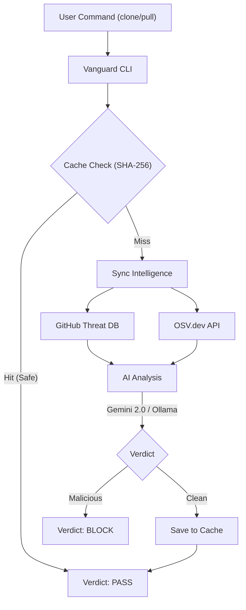

<div align="center">

# 🛡️ Vanguard: AI Supply Chain Firewall
### The Enterprise-Grade Security Layer for Git

[](https://www.npmjs.com/package/vanguard-cli)
[](https://opensource.org/licenses/MIT)
[](https://deepmind.google/technologies/gemini/)
[](https://github.com/bazobehram/vanguard/actions)

<p align="center">
  <b>Intercepts</b> <code>git clone</code> & <code>git pull</code> to detect malware, backdoors, and vulnerabilities <br>
  <b>BEFORE</b> they reach your disk. Powered by Hybrid Intelligence.
</p>

[Installation](#-installation) • [Quick Start](#-quick-start) • [How It Works](#🏗️-architecture) • [Configuration](#⚙️-configuration)

</div>

---

## 🚀 Why Vanguard?

Modern software supply chain attacks are sophisticated. Traditional antiviruses miss them. **Vanguard** acts as a firewall between the internet and your codebase.

*   🧠 **Hybrid Intelligence:** Combines **Google Gemini 2.0**'s reasoning with a curated **Threat Intelligence DB** and **OSV.dev** vulnerability data.
*   ⚡ **Zero-Latency Caching:** Uses SHA-256 hashing to memorize safe files. Re-scanning a project takes milliseconds.
*   🔒 **Privacy First:** Supports **Local Ollama**. Your code never leaves your machine if you choose local models.
*   🛡️ **Proactive Defense:** It doesn't just scan; it intercepts Git commands to prevent bad code from reaching your machine.

---

## 🏗️ Architecture

Vanguard operates as a protective layer between your command line and the remote repository, combining local heuristics with global intelligence.



---

## 📦 Installation

Ensure you have Node.js (v18+) installed.

```bash
npm install -g vanguard-cli
```

---

## 🚀 Quick Start

### ⚙️ Configuration
Setup your Gemini API key or local Ollama endpoint:
```bash
vanguard config
```

### 📥 Secure Clone
Audit and clone any repository in a single command. Vanguard isolates the repo in a sandbox first.
```bash
vanguard clone <repository-url>
```

### 🔄 Secure Pull
Safely update your local codebase. Vanguard audits the diff before merging.
```bash
vanguard pull
```

---

## 🤝 Contribution

We welcome contributors! Please see our [CONTRIBUTING.md](CONTRIBUTING.md) for local setup instructions and the [CODE_OF_CONDUCT.md](CODE_of_CONDUCT.md) for community guidelines.

## 🔐 Security

To report a vulnerability or an exploit bypass, please follow the protocol in [SECURITY.md](SECURITY.md).

---

## ⚖️ License

MIT © 2026 [Behram Bazo](https://github.com/bazob)
